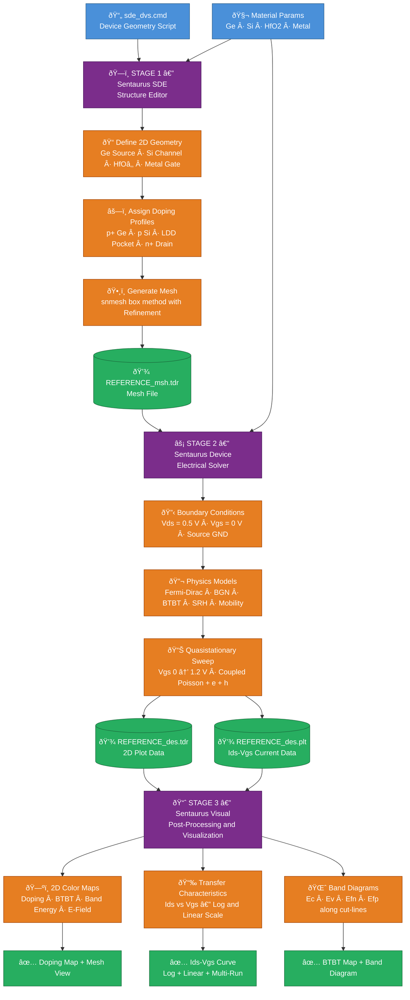

<div align="center">

<h1>
  
</h1>

<h2>🔬 Sentaurus TCAD — Vertical Tunnel Field-Effect Transistor</h2>

[](https://www.synopsys.com/)
[](https://github.com/itzzsamy000/Sentaurus-TCAD-VTFET-Simulation)
[](LICENSE)
[](https://github.com/itzzsamy000)
[](https://github.com/itzzsamy000/Sentaurus-TCAD-VTFET-Simulation)

</div>

---

## 📋 Project Description

This project contains a complete **Synopsys Sentaurus TCAD** simulation of a **Vertical Tunnel Field-Effect Transistor (VTFET)** — a next-generation transistor architecture exploiting **Band-to-Band Tunneling (BTBT)** as its primary transport mechanism.

Unlike conventional MOSFETs, TFETs can achieve **sub-60 mV/decade subthreshold swing**, making them ideal candidates for **ultra-low-power digital applications** in the post-silicon era.

---

## 🔄 Simulation Flow Diagram



> 💡 **Flow:** Input Scripts & Material Params → **SDE** *(Geometry + Doping + Mesh)* → **sdevice** *(Physics + Sweep)* → **SVisual** *(Plots + Band Diagrams)* → **Results**

---

## ✨ Key Features

| Feature | Details |
|:---|:---|
| 🏗️ **Device Structure** | 2D VTFET built with Sentaurus SDE |
| 🧪 **Heterostructure** | Ge source / Si channel / HfO₂ oxide / Metal gate |
| ⚗️ **Doping Profiles** | p⁺ Ge source · p Si channel · LDD pocket · n⁺ Si drain |
| 🔋 **Gate Dielectric** | High-k HfO₂ (1 nm) with metal gate |
| 📐 **Physics Models** | Fermi-Dirac · BGN · BTBT · SRH · Mobility |
| 📈 **Simulation** | Ids–Vgs quasistationary sweep (Vgs: 0 → 1.2 V) |
| 📊 **Post-Processing** | SVisual scripts for result visualization |

---

## 🔧 Technologies Used

<div align="center">

| Tool | Purpose |
|:---:|:---:|
|  | Device geometry & mesh generation |
|  | Band-to-Band tunneling simulation |
|  | Result visualization & plotting |
|  | Simulation flow management |
|  | Device definition scripts |

</div>

---

## 📁 Project Structure

```
Sentaurus-TCAD-VTFET-Simulation/
│
├── 📄 sde_dvs.cmd          ← SDE: device geometry, contacts, doping, meshing
├── 📄 pp1_dvs.cmd          ← SDE post-processing script (variant)
├── 📄 sdevice_des.cmd      ← sdevice: physics, solver, Ids-Vgs sweep
├── 📄 pp2_des.cmd          ← sdevice post-processing script
├── 📄 sdevice.par          ← Global sdevice parameter overrides
│
├── 🧬 Germanium.par        ← Germanium material parameters
├── 🧬 Silicon.par          ← Silicon material parameters
├── 🧬 HfO2.par             ← HfO₂ gate dielectric parameters
├── 🧬 Metal.par            ← Metal gate parameters
│
├── 🖼️  Screenshot/          ← Simulation result screenshots (8 images)
│
└── 📝 README.md            ← Project documentation
```

---

## 📖 Key Simulation Parameters

<div align="center">

| Parameter | Value |
|:---:|:---:|
| Gate Dielectric | HfO₂ — 1 nm |
| Gate Metal | 1 nm |
| Drain Bias (Vds) | 0.5 V |
| Gate Sweep (Vgs) | 0 → 1.2 V |
| Channel Material | Silicon (Si) |
| Source Material | Germanium (Ge) |
| Tunneling Model | Band-to-Band (BTBT) |
| Subthreshold Model | Fermi-Dirac + OldSlotboom BGN |

</div>

---

## 🖼️ Simulation Results & Screenshots

> All results generated using **Synopsys Sentaurus Visual (SVisual)** post-processor.

---

### 🔵 Device Structure — Doping Concentration Map

<div align="center">
<table>
  <tr>
    <td align="center" width="50%">
      
      <br/>
      <b>🗺️ Doping Concentration Map</b>
      <br/>
      <sub>2D color map of doping profile across the VTFET structure (p⁺ Ge source → n⁺ Si drain)</sub>
    </td>
    <td align="center" width="50%">
      
      <br/>
      <b>🕸️ Mesh Structure + Doping (SDE View)</b>
      <br/>
      <sub>Triangular mesh generated by snmesh with doping concentration overlay</sub>
    </td>
  </tr>
</table>
</div>

---

### 📈 Transfer Characteristics — Ids vs Vgs

<div align="center">
<table>
  <tr>
    <td align="center" width="50%">
      
      <br/>
      <b>📉 Ids–Vgs (Log Scale)</b>
      <br/>
      <sub>Transfer characteristics showing BTBT switching behaviour on logarithmic Y-axis</sub>
    </td>
    <td align="center" width="50%">
      
      <br/>
      <b>📈 Ids–Vgs (Linear Scale)</b>
      <br/>
      <sub>Transfer characteristics on linear scale — drain current vs gate voltage sweep</sub>
    </td>
  </tr>
</table>
</div>

---

### 🌈 Multi-Run Comparison & Band Diagrams

<div align="center">
<table>
  <tr>
    <td align="center" width="50%">
      
      <br/>
      <b>📊 Multi-Run Ids Comparison</b>
      <br/>
      <sub>Overlay of transfer curves from REFERENCE_des, _02_des, and _03_des runs</sub>
    </td>
    <td align="center" width="50%">
      
      <br/>
      <b>âš¡ Band-to-Band Generation + Band Diagram</b>
      <br/>
      <sub>2D BTBT generation map (left) and energy band diagram along cut-line (right)</sub>
    </td>
  </tr>
</table>
</div>

---

### 🔬 Conduction Band & Electric Field Analysis

<div align="center">
<table>
  <tr>
    <td align="center" width="50%">
      
      <br/>
      <b>🟠 Conduction Band Energy + Band Diagram</b>
      <br/>
      <sub>ConductionBandEnergy 2D map overlaid with complete energy band diagram</sub>
    </td>
    <td align="center" width="50%">
      
      <br/>
      <b>âš¡ Electric Field + Band Diagram</b>
      <br/>
      <sub>Abs(ElectricField) 2D distribution and corresponding energy band cut-line plot</sub>
    </td>
  </tr>
</table>
</div>

---

## ⚙️ Prerequisites

- ✅ **Synopsys Sentaurus TCAD** (version T-2022.03 or later recommended)
- ✅ Valid **Synopsys FlexLM license**
- ✅ Linux/Unix environment (standard for Sentaurus), or Windows with Cygwin

---

## 🚀 How to Run

### Step 1 — Generate Device Mesh (SDE)
```bash
sde -e -l sde_dvs.cmd
```
> Outputs: `REFERENCE_msh.tdr` — the 2D VTFET mesh file

### Step 2 — Run Electrical Simulation (sdevice)
```bash
sdevice sdevice_des.cmd
```
> Outputs: `REFERENCE_des.tdr` (2D plots) · `REFERENCE_des.plt` (Ids–Vgs data)

### Step 3 — Visualize Results (SVisual)
Open `REFERENCE_des.plt` in **SVisual** to plot transfer characteristics.

---

## 📄 License

This project is for **academic and research purposes**. Please cite appropriately if used in publications.

---

## 👤 Author

<div align="center">

**Satish** — VTFET TCAD Simulation  
[](https://github.com/itzzsamy000)

*Simulation performed at IIIT Bhagalpur — VLSI Lab*

</div>
